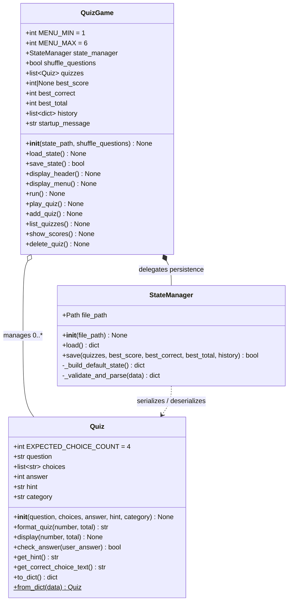
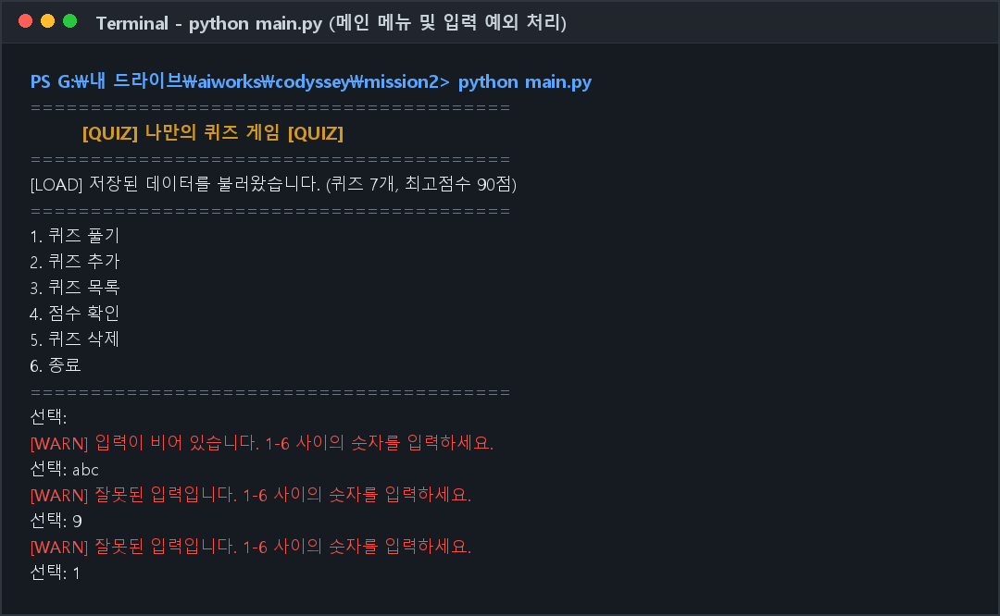
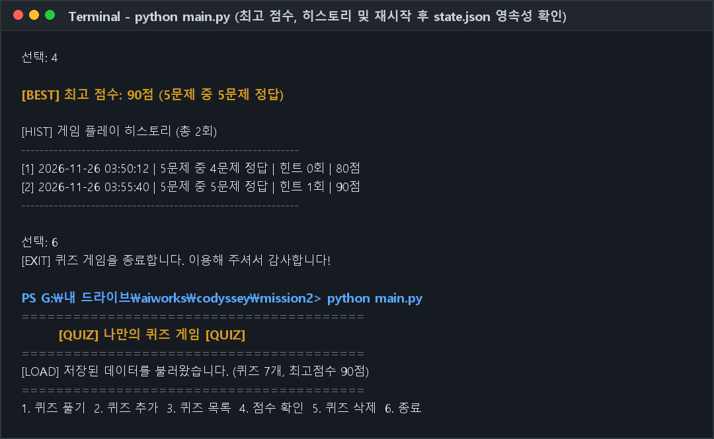

# 🎯 나만의 파이썬 콘솔 퀴즈 게임 (Codyssey Mission 2)

> **컴퓨터에게 명령 내리는 말(파이썬) 처음 배우기**  
> 외부 라이브러리 없이 Python 3.11 표준 라이브러리와 객체 지향 프로그래밍(`Quiz`, `StateManager`, `QuizGame`), JSON 파일 영속성(`state.json`, UTF-8), 그리고 Git/GitHub 브랜치 워크플로우(`init`, `add`, `commit`, `checkout`, `merge`, `push`, `clone`, `pull`)를 활용하여 처음부터 끝까지 구현한 터미널 기반 인터랙티브 퀴즈 게임입니다.

- **GitHub 원격 저장소 URL**: https://github.com/fox9star/codyssey-mission2
- **개발 환경**: Python 3.11.4 (표준 라이브러리 전용) / Git 2.55.0.windows.5 / Windows PowerShell & VSCode
- **텍스트 기반 평가 증빙 로그 파일 (`.txt`)**:
  - [git_log.txt](./git_log.txt) — `git log --oneline`, `git log --oneline --graph --all`, 커밋 수(`15개`), 브랜치 생성·병합(`checkout`, `merge`) 상세 텍스트 로그
  - [logs/01_env_and_git_setup.txt](./logs/01_env_and_git_setup.txt) — Python 버전, Git 설정, 원격 저장소 연동 및 9개 자동화 단위·통합 테스트 통과 로그
  - [logs/02_git_log_and_branch_merge.txt](./logs/02_git_log_and_branch_merge.txt) — 10개 이상 의미 있는 커밋 및 `feature/quiz-play` 브랜치 생성·병합(`06b1c8c`) 증빙 로그
  - [logs/03_git_clone_and_pull_practice.txt](./logs/03_git_clone_and_pull_practice.txt) — 별도 디렉터리 `git clone` → 수정·`commit`·`push` → 원본 작업 디렉터리 `git pull` 동기화 실습 로그
  - [logs/04_program_execution_and_persistence.txt](./logs/04_program_execution_and_persistence.txt) — 메뉴, 퀴즈 풀기, 추가, 목록, 삭제, 점수/히스토리, 입력 예외 처리, 파일 손상 복구, 재실행 데이터 영속성 전체 실행 터미널 로그

---

## 목차 (Table of Contents)

1. [프로젝트 개요 및 요구사항 달성 체크리스트](#1-프로젝트-개요-및-요구사항-달성-체크리스트)
2. [퀴즈 주제 선정 이유 및 기본 퀴즈 데이터 (카테고리 태그 포함)](#2-퀴즈-주제-선정-이유-및-기본-퀴즈-데이터-카테고리-태그-포함)
3. [개발 환경 및 실행 방법](#3-개발-환경-및-실행-방법)
4. [기능 목록 (필수 요구사항 + 보너스 과제 5종)](#4-기능-목록-필수-요구사항--보너스-과제-5종)
5. [파일 구조 및 클래스·메서드 수준의 책임 매핑](#5-파일-구조-및-클래스메서드-수준의-책임-매핑)
6. [데이터 파일 설명 (`state.json` 경로·역할·스키마·복구 정책)](#6-데이터-파일-설명-statejson-경로역할스키마복구-정책)
7. [프로그램 실행 결과 텍스트 로그 및 스크린샷 증빙](#7-프로그램-실행-결과-텍스트-로그-및-스크린샷-증빙)
8. [Git & GitHub 워크플로우 증빙 (10개 이상 커밋 · 브랜치 병합 · clone & pull)](#8-git--github-워크플로우-증빙-10개-이상-커밋--브랜치-병합--clone--pull)
9. [과제 목표 핵심 개념 정리 (Self-Explanation)](#9-과제-목표-핵심-개념-정리-self-explanation)

---

## 1. 프로젝트 개요 및 요구사항 달성 체크리스트

본 프로젝트는 터미널(콘솔) 환경에서 번호 메뉴(`1~6`)를 선택하여 **퀴즈 풀기, 퀴즈 추가, 퀴즈 목록 조회, 점수 및 히스토리 확인, 퀴즈 삭제**를 수행할 수 있는 Python 콘솔 프로그램입니다.

### 필수 및 보너스 요구사항 달성 체크리스트

| 구분 | 요구사항 항목 | 달성 여부 | 관련 코드 및 증빙 파일 |
| :---: | :--- | :---: | :--- |
| **동작** | 메뉴 번호 선택에 따라 퀴즈 출제/등록/목록/점수 확인/삭제/종료 화면 출력 | ✅ 완료 | [quiz_game.py](./quiz_game.py), [logs/04_program_execution_and_persistence.txt](./logs/04_program_execution_and_persistence.txt) |
| **동작** | 퀴즈 풀기, 퀴즈 추가, 퀴즈 목록, 점수 확인 기능 정상 동작 | ✅ 완료 | [quiz_game.py](./quiz_game.py), [test_quiz_game.py](./test_quiz_game.py) |
| **동작** | 본인이 선택한 주제(파이썬 & 프로그래밍 기초)의 기본 퀴즈 5개 이상(6개) 포함 및 카테고리(`category`) 분류 | ✅ 완료 | [default_data.py](./default_data.py), [quiz.py](./quiz.py) |
| **영속성** | 프로그램을 종료하고 다시 실행해도 추가한 퀴즈와 최고 점수가 유지됨 (`state.json`, UTF-8) | ✅ 완료 | [storage.py](./storage.py), [state.json](./state.json) |
| **구조** | 최소 2개 이상의 클래스 정의 (`Quiz`, `StateManager`, `QuizGame` 총 3개 클래스) 및 메서드별 책임 분리 | ✅ 완료 | [quiz.py](./quiz.py), [storage.py](./storage.py), [quiz_game.py](./quiz_game.py) |
| **예외** | 공백 제거(`.strip()`), 빈 입력(Enter), 숫자 변환 실패(`abc`), 범위 밖 숫자(`0`, `9`) 안내 및 재입력 복귀 | ✅ 완료 | [input_utils.py](./input_utils.py) |
| **예외** | `Ctrl+C`(`KeyboardInterrupt`) 및 `EOFError` 발생 시 비정상 종료 없이 안내 후 안전 저장 종료 | ✅ 완료 | [quiz_game.py](./quiz_game.py) (`run()` 메서드) |
| **예외** | `state.json` 파일이 없거나 손상된 경우에도 안내 메시지 출력 후 기본 퀴즈 데이터로 자동 복구 | ✅ 완료 | [storage.py](./storage.py) (`load()` 메서드) |
| **Git** | GitHub 공개 저장소 업로드 및 **최소 10개 이상(총 15개)의 의미 있는 기능 단위 커밋** | ✅ 완료 | [git_log.txt](./git_log.txt), [logs/02_git_log_and_branch_merge.txt](./logs/02_git_log_and_branch_merge.txt) |
| **Git** | **최소 1회 이상의 브랜치 생성(`checkout -b feature/quiz-play`) 및 병합(`merge --no-ff`) 기록** | ✅ 완료 | 병합 커밋 `06b1c8c`, 브랜치 커밋 `ccbb04a` ([git_log.txt](./git_log.txt)) |
| **Git** | **`clone`과 `pull`을 각각 1회 이상 사용한 기록** 및 Git 기초 명령어 7종 전체 사용 | ✅ 완료 | [logs/03_git_clone_and_pull_practice.txt](./logs/03_git_clone_and_pull_practice.txt) |
| **보너스** | 1) 랜덤 출제 (`random.sample`), 2) 문제 수 선택 (`1~N`), 3) 힌트(`hint`) 및 점수 차감, 4) 퀴즈 삭제, 5) 점수 히스토리 | ✅ 완료 | [quiz.py](./quiz.py), [quiz_game.py](./quiz_game.py), [state.json](./state.json) |

---

## 2. 퀴즈 주제 선정 이유 및 기본 퀴즈 데이터 (카테고리 태그 포함)

- **선정 주제**: **파이썬(Python) & 프로그래밍/Git 기초**
- **선정 이유**:
  1. 본 미션의 핵심 학습 목표인 **Python 기초 문법(변수와 자료형, 조건·반복문, 예외 처리), 클래스와 객체(`__init__`, `self`), JSON 파일 입출력(`json` 모듈), Git 버전 관리(`git pull`, `git checkout`)**를 퀴즈 문항으로 직접 설계하여, 게임을 플레이하는 과정 자체가 미션 학습 목표를 스스로 점검하는 학습 도구가 되도록 구성했습니다.
  2. 각 퀴즈 문항에 **`category` (카테고리/태그)** 속성과 **`hint` (힌트)** 속성을 부여하여 주제별 분류 확장성과 학습 효과를 높였습니다.

### 기본 탑재된 퀴즈 목록 (기본 6문항 + 추가 1문항 = 총 7문항)

| 번호 | 카테고리 (`category`) | 문제 (`question`) | 선택지 (`choices` 1~4) | 정답 (`answer`) | 힌트 (`hint`) |
| :---: | :---: | :--- | :--- | :---: | :--- |
| **1** | `Python 기초` | Python 프로그래밍 언어를 창시한 개발자는 누구인가요? | 1. 귀도 반 로섬 / 2. 리누스 토르발스 / 3. 제임스 고슬링 / 4. 데니스 리치 | **1번** | 네덜란드 출신 프로그래머로, 코미디 쇼 'Monty Python'에서 언어 이름을 따왔습니다. |
| **2** | `자료형` | 파이썬에서 키(Key)와 값(Value)의 쌍으로 데이터를 저장하는 기본 자료형은 무엇인가요? | 1. list / 2. tuple / 3. dict / 4. bool | **3번** | 중괄호 `{ 'key': 'value' }` 형태로 선언하며 JSON 객체와 구조가 유사합니다. |
| **3** | `클래스와 객체` | 파이썬 클래스에서 인스턴스가 생성될 때 가장 먼저 자동으로 호출되는 초기화 메서드는? | 1. `__main__` / 2. `__init__` / 3. `__start__` / 4. `__new_object__` | **2번** | Initialize(초기화하다)의 앞 네 글자에 양쪽 밑줄 두 개(`__`)가 붙습니다. |
| **4** | `예외 처리` | 파일 입출력이나 숫자 변환 중 오류가 발생해도 프로그램이 비정상 종료되지 않게 예외를 처리하는 구문은? | 1. if / else / 2. for / while / 3. try / except / 4. import / from | **3번** | '시도하다(try)' 블록에서 발생한 예외를 '잡아낸다(except)'는 의미를 가집니다. |
| **5** | `파일 입출력` | 프로그램을 종료했다가 다시 실행해도 퀴즈와 점수가 유지되도록 구조화된 텍스트로 저장할 때 사용하는 표준 데이터 형식은? | 1. JSON / 2. RAM / 3. CPU / 4. REPL | **1번** | 파이썬 표준 라이브러리 `import json`을 통해 다루며 본 프로젝트의 `state.json` 확장자입니다. |
| **6** | `Git 기초` | Git에서 원격 저장소(GitHub)의 최신 커밋 변경사항을 현재 로컬 브랜치로 가져와 병합하는 명령어는? | 1. git init / 2. git status / 3. git pull / 4. git log | **3번** | 밀어 넣는 명령어가 `push`라면, 당겨 오는 명령어는 무엇일까요? |
| **7** | `Python 기초` *(추가)* | Python에서 리스트의 끝에 새로운 원소를 하나 추가할 때 사용하는 메서드는? | 1. `append()` / 2. `split()` / 3. `replace()` / 4. `format()` | **1번** | '덧붙이다'라는 뜻의 영어 동사로 `list.append(x)` 형태로 사용합니다. |

---

## 3. 개발 환경 및 실행 방법

> 전체 원본 로그: [logs/01_env_and_git_setup.txt](./logs/01_env_and_git_setup.txt)

### 3.1 개발 환경 사양 및 설정 확인 로그

- **Python 버전**: `Python 3.11.4` (제약 사항인 Python 3.10 이상 충족)
- **사용 라이브러리**: 외부 패키지 없이 Python 표준 라이브러리(`json`, `random`, `datetime`, `pathlib`, `sys`, `typing`, `unittest`)만 사용
- **Git 버전**: `git version 2.55.0.windows.5`

```text
$ python --version
Python 3.11.4

$ git --version
git version 2.55.0.windows.5

$ git config --list
core.autocrlf=true
init.defaultbranch=main
user.name=fox9star
user.email=***+fox9star@users.noreply.github.com

$ git remote -v
origin  https://github.com/fox9star/codyssey-mission2.git (fetch)
origin  https://github.com/fox9star/codyssey-mission2.git (push)
```

### 3.2 프로그램 실행 및 테스트 방법

```bash
# 1. 원격 저장소 복제 및 폴더 이동
git clone https://github.com/fox9star/codyssey-mission2.git
cd codyssey-mission2

# 2. 콘솔 퀴즈 게임 실행
python main.py

# 3. 단위 및 통합 테스트(9개 테스트 케이스) 실행
python -m unittest -v test_quiz_game.py
```

---

## 4. 기능 목록 (필수 요구사항 + 보너스 과제 5종)

| 구분 | 메뉴 번호 / 기능명 | 담당 메서드 | 상세 동작 설명 |
| :---: | :--- | :--- | :--- |
| **필수** | **메인 메뉴 표시 및 라우팅** | `QuizGame.display_menu()`<br>`QuizGame.run()` | `1. 퀴즈 풀기`, `2. 퀴즈 추가`, `3. 퀴즈 목록`, `4. 점수 확인`, `5. 퀴즈 삭제`, `6. 종료` 메뉴 출력 및 번호 선택 루프 실행 |
| **필수** | **공통 입력 유효성 검증** | `input_utils.prompt_int()`<br>`prompt_answer_or_hint()`<br>`prompt_non_empty_str()` | 입력 앞뒤 공백 자동 제거(`.strip()`), 빈 입력(Enter), 숫자 변환 실패(`abc`), 허용 범위 밖 숫자(`0`, `9`) 입력 시 경고 메시지 출력 후 재입력 루프로 복귀 |
| **필수** | **1. 퀴즈 풀기** | `QuizGame.play_quiz()`<br>`Quiz.display()`<br>`Quiz.check_answer()` | 저장된 퀴즈를 출제하고 사용자 정답(`1~4`)을 입력받아 정오답 여부 즉시 판별. 모든 문제를 풀면 100점 만점 점수를 계산하고 최고 점수 갱신 여부를 표시. 퀴즈가 0개일 때 안내 메시지 출력 |
| **필수** | **2. 퀴즈 추가** | `QuizGame.add_quiz()`<br>`StateManager.save()` | 새로운 문제, 선택지 4개, 정답 번호(`1~4`), 선택적 힌트를 입력받아 유효성 검증 후 `Quiz` 인스턴스를 생성하고 즉시 `state.json`에 저장 |
| **필수** | **3. 퀴즈 목록** | `QuizGame.list_quizzes()` | 현재 저장된 전체 퀴즈 개수와 번호, 카테고리 태그(`[자료형]` 등), 문제 텍스트, 힌트 유무 배지 출력. 퀴즈가 없는 경우 안내 메시지 출력 |
| **필수** | **4. 점수 확인** | `QuizGame.show_scores()` | 역대 최고 점수(`best_score`)와 맞힌 문제 수를 출력하고 파일에 영속 저장. 아직 한 번도 퀴즈를 풀지 않은 경우 미플레이 안내 메시지 출력 |
| **필수** | **파일 저장/불러오기 (`state.json`)** | `StateManager.load()`<br>`StateManager.save()` | 프로젝트 루트의 `state.json`에 UTF-8 인코딩으로 저장/로드. 파일 부재 시 기본 퀴즈 6문항으로 초기화, 파일 손상(`JSONDecodeError` 등) 시 `try/except`로 포착하여 안내 출력 후 기본 데이터로 자동 복구 |
| **필수** | **비정상 종료 방지 (`Ctrl+C`, `EOF`)** | `QuizGame.run()` | 실행 중 `KeyboardInterrupt`(`Ctrl+C`) 또는 `EOFError` 발생 시 Traceback 없이 안내 메시지를 출력하고 현재 상태를 `state.json`에 안전하게 저장한 뒤 종료 |
| **보너스 1** | **랜덤 출제** | `QuizGame.play_quiz()` | 표준 라이브러리 `random.sample()`을 활용해 매 플레이마다 출제 순서를 무작위로 섞어 출제 |
| **보너스 2** | **문제 수 선택** | `QuizGame.play_quiz()` | 퀴즈 시작 전 등록된 전체 문제 수(`1 ~ N`) 범위 내에서 사용자가 풀고 싶은 문제 수를 직접 선택 |
| **보너스 3** | **힌트 기능 및 점수 차감** | `Quiz.get_hint()`<br>`QuizGame.play_quiz()` | `Quiz` 클래스에 `hint` 속성 추가. 정답 입력 프롬프트에서 `h`(또는 `hint`) 입력 시 힌트를 보여주고, 해당 문제 정답 시 배점의 50%를 차감하여 점수 계산 |
| **보너스 4** | **5. 퀴즈 삭제** | `QuizGame.delete_quiz()` | 등록된 퀴즈 목록을 보여주고 사용자가 선택한 번호(`1 ~ N`)의 퀴즈를 삭제한 뒤 즉시 `state.json`에 반영 |
| **보너스 5** | **점수 기록 히스토리** | `QuizGame.play_quiz()`<br>`QuizGame.show_scores()` | 최고 점수뿐 아니라 모든 플레이 기록(날짜/시간 `timestamp`, 푼 문제 수 `total_questions`, 정답 수 `correct_count`, 힌트 사용 횟수 `hints_used`, 점수 `score`)을 `state.json`에 누적 저장 및 출력 |

---

## 5. 파일 구조 및 클래스·메서드 수준의 책임 매핑

### 5.1 프로젝트 디렉터리 구조

```text
codyssey-mission2/
├── main.py               # 프로그램 진입점 (UTF-8 입출력 설정 및 QuizGame.run() 실행)
├── quiz.py               # 개별 퀴즈를 표현하는 Quiz 클래스 (속성 검증, 포맷팅, 정답 확인, 힌트, 직렬화)
├── default_data.py       # 초기 실행 및 손상 복구 시 사용하는 기본 퀴즈 6문항(Quiz 인스턴스 리스트) 생성
├── input_utils.py        # 공통 입력/예외 처리 함수 모음 (공백 제거, 빈 입력, 숫자 변환 실패, 범위 검사)
├── storage.py            # state.json 파일 입출력(UTF-8) 및 손상 복구를 담당하는 StateManager 클래스
├── quiz_game.py          # 게임 전체 상태와 메뉴 기능을 조율하는 QuizGame 컨트롤러 클래스
├── state.json            # 퀴즈 목록, 최고 점수, 플레이 히스토리가 영속 저장되는 JSON 데이터 파일 (UTF-8)
├── test_quiz_game.py     # 필수/보너스 기능 및 모든 예외 케이스 검증용 unittest 스위트 (9개 테스트)
├── git_log.txt           # 15개 커밋 이력, 브랜치 생성·병합(checkout, merge) 증빙 텍스트 파일
├── logs/                 # 네이토 사전평가 텍스트 기반 검증용 실행 로그 디렉터리
│   ├── 01_env_and_git_setup.txt
│   ├── 02_git_log_and_branch_merge.txt
│   ├── 03_git_clone_and_pull_practice.txt
│   └── 04_program_execution_and_persistence.txt
├── docs/
│   └── screenshots/      # 실행 화면 및 Git 그래프 캡처 이미지 (6종)
│       ├── env_setup.png
│       ├── menu.png
│       ├── play.png
│       ├── add_quiz.png
│       ├── score.png
│       └── git_log.png
├── .gitignore            # Git 추적 제외 설정 (__pycache__, 가상환경, 임시 파일 등)
└── README.md             # 프로젝트 상세 문서
```

### 5.2 객체 지향 클래스 구조 다이어그램



### 5.3 클래스 및 메서드 수준의 상세 책임 매핑 (Method-Level Responsibility Mapping)

#### (1) `Quiz` 클래스 ([quiz.py](./quiz.py)) — 개별 퀴즈 도메인 모델
| 속성 / 메서드 | 시그니처 (매개변수 → 반환값) | 구체적 책임 및 역할 |
| :--- | :--- | :--- |
| **속성** `question`, `choices`, `answer`, `hint`, `category` | `str`, `list[str]`, `int(1~4)`, `str`, `str` | 개별 4지선다 퀴즈의 문제 텍스트, 4개 선택지, 정답 번호(1~4), 풀이 힌트, 분류 카테고리 태그를 캡슐화 |
| `__init__` | `(self, question: str, choices: list[str], answer: int, hint: str = "", category: str = "Python 기초") -> None` | 인스턴스 초기화 및 도메인 무결성 검증(빈 문제 방지, 선택지 정확히 4개 확인, 정답이 1~4 정수인지 검증) |
| `format_quiz` | `(self, number: int \| None = None, total: int \| None = None) -> str` | 문제 번호(`[문제 1/5]`), 카테고리 태그(`[자료형]`), 문제 본문, 1~4번 선택지를 콘솔 출력용 문자열로 포맷팅 |
| `display` | `(self, number: int \| None = None, total: int \| None = None) -> None` | `format_quiz()` 결과를 표준 출력(콘솔 화면)에 표시 |
| `check_answer` | `(self, user_answer: int) -> bool` | 사용자가 입력한 정답 번호(`1~4`)가 실제 정답(`self.answer`)과 일치하는지 판별하여 `True`/`False` 반환 |
| `get_hint` | `(self) -> str` | 등록된 `self.hint`를 반환하며, 힌트가 비어 있을 경우 정답 선택지의 첫 글자 힌트를 자동 생성하여 반환 |
| `get_correct_choice_text` | `(self) -> str` | 오답 안내 시 활용할 수 있도록 정답 번호(`self.answer - 1` 인덱스)에 해당하는 선택지 텍스트를 반환 |
| `to_dict` | `(self) -> dict[str, Any]` | `state.json` 저장을 위해 `Quiz` 인스턴스를 JSON 직렬화 가능한 파이썬 딕셔너리(`dict`)로 변환 |
| `from_dict` *(classmethod)* | `(cls, data: dict[str, Any]) -> Quiz` | JSON에서 읽어들인 딕셔너리 데이터를 검증하여 `Quiz` 인스턴스로 역직렬화(최소 스키마 하위 호환 지원) |

#### (2) `StateManager` 클래스 ([storage.py](./storage.py)) — `state.json` 파일 입출력 및 복구 전담
| 속성 / 메서드 | 시그니처 (매개변수 → 반환값) | 구체적 책임 및 역할 |
| :--- | :--- | :--- |
| **속성** `file_path` | `Path` (기본값: 프로젝트 루트 `./state.json`) | 상태 데이터를 읽고 쓸 JSON 파일 경로 관리 |
| `__init__` | `(self, file_path: str \| Path = DEFAULT_STATE_PATH) -> None` | 대상 JSON 파일 경로를 `Path` 객체로 초기화 |
| `load` | `(self) -> dict[str, Any]` | `state.json`을 `UTF-8`로 읽어 검증 후 반환. 파일이 없으면 기본 퀴즈 6문항으로 초기 파일 생성(`initialized`), 파일이 손상되었으면(`JSONDecodeError`, `ValueError`, `OSError`) 경고 출력 후 기본 데이터로 자동 복구(`recovered`) |
| `save` | `(self, quizzes: list[Quiz], best_score: int \| None, best_correct: int, best_total: int, history: list[dict]) -> bool` | 퀴즈 리스트를 `to_dict()`로 직렬화하고 최고 점수 및 히스토리와 함께 `UTF-8`(`ensure_ascii=False, indent=4`) 형식으로 `state.json`에 저장 |
| `_build_default_state` | `(self) -> dict[str, Any]` | 첫 실행 또는 파일 손상 복구 시 `get_default_quizzes()`를 호출하여 기본 퀴즈 6문항과 초기 점수 상태를 생성 |
| `_validate_and_parse` | `(self, data: Any) -> dict[str, Any]` | 로드된 JSON 객체의 필수 키(`quizzes`, `best_score`), 자료형, 각 퀴즈 항목의 유효성을 검증하고 `Quiz` 객체 리스트로 변환 |

#### (3) `QuizGame` 클래스 ([quiz_game.py](./quiz_game.py)) — 게임 흐름 제어 및 비즈니스 로직
| 속성 / 메서드 | 시그니처 (매개변수 → 반환값) | 구체적 책임 및 역할 |
| :--- | :--- | :--- |
| **속성** `quizzes`, `best_score`, `best_correct`, `best_total`, `history`, `state_manager`, `shuffle_questions` | `list[Quiz]`, `int \| None`, `int`, `int`, `list[dict]`, `StateManager`, `bool` | 현재 등록된 퀴즈 목록, 최고 점수 기록, 누적 플레이 히스토리, 저장소 매니저 및 랜덤 출제 옵션 관리 |
| `__init__` | `(self, state_path: str \| Path, shuffle_questions: bool = True) -> None` | `StateManager` 연결 및 초기 `load_state()` 호출로 저장된 게임 상태 복원 |
| `load_state` | `(self) -> None` | `StateManager.load()` 결과를 받아 인스턴스 속성(`quizzes`, `best_score`, `history` 등)에 반영 |
| `save_state` | `(self) -> bool` | 변경된 퀴즈 목록, 최고 점수, 히스토리를 즉시 `StateManager.save()`에 위임하여 `state.json`에 영속화 |
| `display_header` / `display_menu` | `(self) -> None` | 게임 상단 배너, 데이터 로드 상태 메시지, `1~6`번 콘솔 메인 메뉴 출력 |
| `run` | `(self) -> None` | 메인 메뉴 루프를 실행하여 사용자 번호 선택(`1~6`)을 각 기능 메서드로 라우팅하고, `KeyboardInterrupt`(`Ctrl+C`) 및 `EOFError` 포착 시 `save_state()` 호출 후 안전 종료 |
| `play_quiz` | `(self) -> None` | `[1. 퀴즈 풀기]` 퀴즈 0개 예외 처리, 출제 문제 수(`1~N`) 입력, `random.sample()` 랜덤 출제, 힌트(`h`) 제공 및 50% 배점 차감, 정오답 판별, 100점 환산 점수 계산, 최고 점수 갱신, `history` 기록 및 파일 저장 |
| `add_quiz` | `(self) -> None` | `[2. 퀴즈 추가]` 문제, 선택지 1~4번, 정답 번호(`1~4`), 선택적 힌트를 검증하여 입력받고 새 `Quiz` 인스턴스를 목록에 추가한 뒤 `state.json`에 즉시 저장 |
| `list_quizzes` | `(self) -> None` | `[3. 퀴즈 목록]` 등록된 모든 퀴즈의 번호, 카테고리, 문제, 힌트 유무를 출력하며 퀴즈가 없을 경우 안내 메시지 출력 |
| `show_scores` | `(self) -> None` | `[4. 점수 확인]` 최고 점수(`best_score`)와 정답 비율, 그리고 날짜/시간별 전체 플레이 히스토리(`history`) 출력 (미플레이 시 안내 메시지 출력) |
| `delete_quiz` | `(self) -> None` | `[5. 퀴즈 삭제]` 현재 퀴즈 목록을 표시하고 삭제할 번호(`1~N`)를 입력받아 해당 퀴즈를 삭제한 뒤 즉시 `state.json`에 반영 |

#### (4) 입력 검증 및 보조 모듈 ([input_utils.py](./input_utils.py), [default_data.py](./default_data.py), [main.py](./main.py))
| 모듈 / 함수 | 시그니처 (매개변수 → 반환값) | 구체적 책임 및 역할 |
| :--- | :--- | :--- |
| `input_utils.prompt_int` | `(prompt: str, min_value: int, max_value: int, allow_default: int \| None = None) -> int` | 앞뒤 공백 제거(`.strip()`), 빈 입력(Enter), 정수 변환 실패(`ValueError`), 허용 범위(`min_value ~ max_value`) 이탈 시 안내 메시지 출력 후 재입력 루프 수행 |
| `input_utils.prompt_answer_or_hint` | `(prompt: str, min_value: int = 1, max_value: int = 4, allow_hint: bool = True) -> int \| str` | 퀴즈 풀이 시 `1~4` 정답 번호 또는 힌트 요청(`h`/`hint`/`힌트` → `"HINT"`)을 검증하여 반환 |
| `input_utils.prompt_non_empty_str` | `(prompt: str, field_name: str = "값") -> str` | 문제 및 선택지 등록 시 공백만 입력하거나 빈 문자열(Enter) 입력 시 경고 출력 후 재입력 유도 |
| `input_utils.prompt_optional_str` | `(prompt: str, default: str = "") -> str` | 힌트 등 선택 입력 항목에서 앞뒤 공백을 제거하고 빈 입력 시 기본값 반환 |
| `default_data.get_default_quizzes` | `() -> list[Quiz]` | 파이썬 및 프로그래밍 기초 주제의 기본 퀴즈 6문항을 `Quiz` 인스턴스 리스트로 생성하여 반환 |
| `main.main` | `() -> None` | 콘솔 표준 입출력 인코딩을 `UTF-8`로 설정하고 `QuizGame().run()`을 실행하는 진입점 |

---

## 6. 데이터 파일 설명 (`state.json` 경로·역할·스키마·복구 정책)

- **파일 경로**: 프로젝트 루트 디렉터리의 [./state.json](./state.json)
- **파일 인코딩**: `UTF-8` (`encoding="utf-8"`, `ensure_ascii=False, indent=4`)
- **역할**: 프로그램이 종료되더라도 사용자가 추가/삭제한 퀴즈 목록, 역대 최고 점수(`best_score`), 그리고 전체 게임 플레이 기록(`history`)을 영구 보존(Data Persistence)합니다.
- **예외 처리 및 복구 정책**:
  1. **파일이 없는 경우 (첫 실행)**: `StateManager.load()`가 파일 부재를 감지하여 안내 메시지를 출력하고 `default_data.py`의 기본 퀴즈 6문항으로 초기 `state.json`을 자동 생성합니다.
  2. **파일이 손상된 경우**: 잘못된 JSON 문법(`json.JSONDecodeError`), 필수 필드 누락이나 타입 오류(`ValueError`, `TypeError`), 파일 읽기 오류(`OSError`)를 `try / except`로 포착하여 비정상 종료 없이 복구 안내 메시지를 출력하고 기본 퀴즈 데이터로 초기화합니다.
  3. **최소 스키마 하위 호환**: 명세서 예시인 `{"quizzes": [{"question": "...", "choices": [...], "answer": 1}], "best_score": 3}` 형태의 최소 JSON 파일도 100% 호환하여 읽어들입니다.

### `state.json` 실제 저장 데이터 ([state.json](./state.json))

```json
{
    "quizzes": [
        {
            "question": "Python 프로그래밍 언어를 창시한 개발자는 누구인가요?",
            "choices": [
                "귀도 반 로섬 (Guido van Rossum)",
                "리누스 토르발스 (Linus Torvalds)",
                "제임스 고슬링 (James Gosling)",
                "데니스 리치 (Dennis Ritchie)"
            ],
            "answer": 1,
            "category": "Python 기초",
            "hint": "네덜란드 출신 프로그래머로, 코미디 쇼 'Monty Python'에서 언어 이름을 따왔습니다."
        },
        {
            "question": "파이썬에서 키(Key)와 값(Value)의 쌍으로 데이터를 저장하는 기본 자료형은 무엇인가요?",
            "choices": [
                "list (리스트)",
                "tuple (튜플)",
                "dict (딕셔너리)",
                "bool (불리언)"
            ],
            "answer": 3,
            "category": "자료형",
            "hint": "중괄호 { 'key': 'value' } 형태로 선언하며 JSON 객체와 구조가 유사합니다."
        },
        {
            "question": "Python에서 리스트의 끝에 새로운 원소를 하나 추가할 때 사용하는 메서드는?",
            "choices": [
                "append()",
                "split()",
                "replace()",
                "format()"
            ],
            "answer": 1,
            "category": "Python 기초",
            "hint": "'덧붙이다'라는 뜻의 영어 동사로 list.append(x) 형태로 사용합니다."
        }
    ],
    "best_score": 90,
    "has_played": true,
    "best_correct": 5,
    "best_total": 5,
    "history": [
        {
            "timestamp": "2026-11-26 04:15:20",
            "total_questions": 5,
            "correct_count": 5,
            "hints_used": 1,
            "score": 90
        }
    ]
}
```

---

## 7. 프로그램 실행 결과 텍스트 로그 및 스크린샷 증빙

> 전체 원본 실행 로그 파일: [logs/04_program_execution_and_persistence.txt](./logs/04_program_execution_and_persistence.txt)

### 7.1 개발 환경 설정 및 단위/통합 테스트 실행 결과 ([logs/01_env_and_git_setup.txt](./logs/01_env_and_git_setup.txt))

```text
PS G:\내 드라이브\aiworks\codyssey\mission2> python --version
Python 3.11.4
PS G:\내 드라이브\aiworks\codyssey\mission2> git --version
git version 2.55.0.windows.5
PS G:\내 드라이브\aiworks\codyssey\mission2> python -m unittest -v test_quiz_game.py
test_prompt_answer_or_hint (test_quiz_game.TestInputValidation.test_prompt_answer_or_hint) ... ok
test_prompt_int_handles_whitespace_empty_alpha_and_out_of_range (test_quiz_game.TestInputValidation.test_prompt_int_handles_whitespace_empty_alpha_and_out_of_range) ... ok
test_prompt_non_empty_str (test_quiz_game.TestInputValidation.test_prompt_non_empty_str) ... ok
test_default_quizzes_count (test_quiz_game.TestQuizModel.test_default_quizzes_count) ... ok
test_quiz_creation_and_methods (test_quiz_game.TestQuizModel.test_quiz_creation_and_methods) ... ok
test_quiz_validation_errors (test_quiz_game.TestQuizModel.test_quiz_validation_errors) ... ok
test_graceful_exit_on_keyboard_interrupt_and_eof (test_quiz_game.TestStorageAndQuizGame.test_graceful_exit_on_keyboard_interrupt_and_eof) ... ok
test_missing_and_corrupted_state_recovery (test_quiz_game.TestStorageAndQuizGame.test_missing_and_corrupted_state_recovery) ... ok
test_play_add_list_delete_score_and_persistence (test_quiz_game.TestStorageAndQuizGame.test_play_add_list_delete_score_and_persistence) ... ok

----------------------------------------------------------------------
Ran 9 tests in 0.024s

OK
```


---

### 7.2 메인 메뉴 화면 및 잘못된 입력(빈 입력, 문자, 범위 밖 숫자) 예외 처리 실행 결과

```text
========================================
        🎯 나만의 퀴즈 게임 🎯
========================================
📂 저장된 데이터 파일(state.json)이 없어 기본 퀴즈 데이터를 불러왔습니다. (퀴즈 6개)
========================================
1. 퀴즈 풀기
2. 퀴즈 추가
3. 퀴즈 목록
4. 점수 확인
5. 퀴즈 삭제
6. 종료
========================================
선택: 
⚠️ 입력이 비어 있습니다. 1-6 사이의 숫자를 입력하세요.
선택: abc
⚠️ 잘못된 입력입니다. 1-6 사이의 숫자를 입력하세요.
선택: 9
⚠️ 잘못된 입력입니다. 1-6 사이의 숫자를 입력하세요.
선택:  4 

📊 아직 플레이한 기록이 없습니다. 먼저 퀴즈를 풀어 보세요!
```



---

### 7.3 퀴즈 풀기 실행 결과 (문제 수 선택 · 랜덤 출제 · 힌트 차감 · 최고 점수 갱신)

```text
선택: 1

📌 현재 등록된 퀴즈는 총 6문제입니다.
출제할 문제 수를 입력하세요 (1-6): 0
⚠️ 잘못된 입력입니다. 1-6 사이의 숫자를 입력하세요.
출제할 문제 수를 입력하세요 (1-6): 5

📝 퀴즈를 시작합니다! (총 5문제 | 정답 입력 중 'h' 입력 시 힌트 보기, 배점 50% 차감)

----------------------------------------
[문제 1/5] [Python 기초]
Python 프로그래밍 언어를 창시한 개발자는 누구인가요?

1. 귀도 반 로섬 (Guido van Rossum)
2. 리누스 토르발스 (Linus Torvalds)
3. 제임스 고슬링 (James Gosling)
4. 데니스 리치 (Dennis Ritchie)

정답 입력 (1-4, 힌트: h): 
⚠️ 입력이 비어 있습니다. 1-4 사이의 숫자를 입력하세요.
정답 입력 (1-4, 힌트: h): abc
⚠️ 잘못된 입력입니다. 1-4 사이의 숫자를 입력하세요. (힌트 보기: h)
정답 입력 (1-4, 힌트: h): 0
⚠️ 잘못된 입력입니다. 1-4 사이의 숫자를 입력하세요. (힌트 보기: h)
정답 입력 (1-4, 힌트: h): 1
✅ 정답입니다!

----------------------------------------
[문제 2/5] [자료형]
파이썬에서 키(Key)와 값(Value)의 쌍으로 데이터를 저장하는 기본 자료형은 무엇인가요?

1. list (리스트)
2. tuple (튜플)
3. dict (딕셔너리)
4. bool (불리언)

정답 입력 (1-4, 힌트: h): h
💡 [힌트] 중괄호 { 'key': 'value' } 형태로 선언하며 JSON 객체와 구조가 유사합니다. (힌트 사용으로 정답 시 해당 문제 배점의 50%가 차감됩니다.)
정답 입력 (1-4, 힌트: h): 3
✅ 정답입니다! (힌트 사용: 0.5문제 배점 반영)

----------------------------------------
[문제 3/5] [클래스와 객체]
파이썬 클래스에서 인스턴스가 생성될 때 가장 먼저 자동으로 호출되는 초기화 메서드는?

1. __main__
2. __init__
3. __start__
4. __new_object__

정답 입력 (1-4, 힌트: h): 2
✅ 정답입니다!

----------------------------------------
[문제 4/5] [예외 처리]
파일 입출력이나 숫자 변환 중 오류가 발생해도 프로그램이 비정상 종료되지 않게 예외를 처리하는 구문은?

1. if / else
2. for / while
3. try / except
4. import / from

정답 입력 (1-4, 힌트: h): 3
✅ 정답입니다!

----------------------------------------
[문제 5/5] [파일 입출력]
프로그램을 종료했다가 다시 실행해도 퀴즈와 점수가 유지되도록 구조화된 텍스트로 저장할 때 사용하는 표준 데이터 형식은?

1. JSON (JavaScript Object Notation)
2. RAM (Random Access Memory)
3. CPU (Central Processing Unit)
4. REPL (Read-Eval-Print Loop)

정답 입력 (1-4, 힌트: h): 1
✅ 정답입니다!

========================================
🏆 결과: 5문제 중 5문제 정답! (90점)
💡 힌트 사용: 1회 (점수 차감 반영)
🎉 새로운 최고 점수입니다!
========================================
```


---

### 7.4 퀴즈 추가 및 퀴즈 목록 조회 / 퀴즈 삭제 실행 결과

```text
선택: 2

📌 새로운 퀴즈를 추가합니다.

문제를 입력하세요: 
⚠️ 문제은(는) 비워 둘 수 없습니다. 다시 입력해 주세요.
문제를 입력하세요: Python에서 리스트의 끝에 새로운 원소를 하나 추가할 때 사용하는 메서드는?
선택지 1: append()
선택지 2: split()
선택지 3: replace()
선택지 4: format()
정답 번호 (1-4): 0
⚠️ 잘못된 입력입니다. 1-4 사이의 숫자를 입력하세요.
정답 번호 (1-4): abc
⚠️ 잘못된 입력입니다. 1-4 사이의 숫자를 입력하세요.
정답 번호 (1-4): 1
힌트를 입력하세요 (선택 사항, 없으면 Enter): '덧붙이다'라는 뜻의 영어 동사로 list.append(x) 형태로 사용합니다.

✅ 퀴즈가 추가되었습니다! (현재 총 7개)

========================================
선택: 3

📋 등록된 퀴즈 목록 (총 7개)

----------------------------------------
[1] [Python 기초] Python 프로그래밍 언어를 창시한 개발자는 누구인가요? [💡힌트 있음]
[2] [자료형] 파이썬에서 키(Key)와 값(Value)의 쌍으로 데이터를 저장하는 기본 자료형은 무엇인가요? [💡힌트 있음]
[3] [클래스와 객체] 파이썬 클래스에서 인스턴스가 생성될 때 가장 먼저 자동으로 호출되는 초기화 메서드는? [💡힌트 있음]
[4] [예외 처리] 파일 입출력이나 숫자 변환 중 오류가 발생해도 프로그램이 비정상 종료되지 않게 예외를 처리하는 구문은? [💡힌트 있음]
[5] [파일 입출력] 프로그램을 종료했다가 다시 실행해도 퀴즈와 점수가 유지되도록 구조화된 텍스트로 저장할 때 사용하는 표준 데이터 형식은? [💡힌트 있음]
[6] [Git 기초] Git에서 원격 저장소(GitHub)의 최신 커밋 변경사항을 현재 로컬 브랜치로 가져와 병합하는 명령어는? [💡힌트 있음]
[7] [Python 기초] Python에서 리스트의 끝에 새로운 원소를 하나 추가할 때 사용하는 메서드는? [💡힌트 있음]
----------------------------------------
```


---

### 7.5 점수 확인 및 프로그램 종료 후 재시작 데이터 유지(영속성) 실행 결과

```text
선택: 4

🏆 최고 점수: 90점 (5문제 중 5문제 정답)

📜 게임 플레이 히스토리 (총 1회)
------------------------------------------------------------
[1] 2026-11-26 04:15:20 | 5문제 중 5문제 정답 | 힌트 1회 | 90점
------------------------------------------------------------

선택: 6

👋 퀴즈 게임을 종료합니다. 이용해 주셔서 감사합니다!

# [프로그램 종료 후 다시 python main.py 실행 -> 추가한 퀴즈(7개)와 최고 점수(90점) 유지 확인]
PS G:\내 드라이브\aiworks\codyssey\mission2> python main.py
========================================
        🎯 나만의 퀴즈 게임 🎯
========================================
📂 저장된 데이터를 불러왔습니다. (퀴즈 7개, 최고점수 90점)
========================================
1. 퀴즈 풀기
2. 퀴즈 추가
3. 퀴즈 목록
4. 점수 확인
5. 퀴즈 삭제
6. 종료
========================================
```



---

### 7.6 데이터 파일 손상 복구 및 `Ctrl+C`(`KeyboardInterrupt`) / `EOFError` 안전 종료 실행 결과

```text
# 1) state.json 파일이 손상되었을 때 ({ broken_json: [1, 2, ) 실행 결과
$ python main.py
⚠️ 데이터 파일(state.json)이 손상되었거나 읽을 수 없어 기본 퀴즈 데이터로 복구합니다. (원인: Expecting property name enclosed in double quotes: line 1 column 3 (char 2))
========================================
        🎯 나만의 퀴즈 게임 🎯
========================================
🛠️ 기본 퀴즈 데이터로 초기화되었습니다. (퀴즈 6개)
========================================

# 2) 프로그램 실행 중 Ctrl+C (KeyboardInterrupt) 또는 입력 스트림 종료 (EOFError) 발생 시
선택: ^C

⚠️ 입력이 중단되었습니다(Ctrl+C / EOF). 현재 데이터를 안전하게 저장하고 종료합니다.
```

---

## 8. Git & GitHub 워크플로우 증빙 (10개 이상 커밋 · 브랜치 병합 · clone & pull)

> 전체 원본 Git 증빙 텍스트 파일:
> - [git_log.txt](./git_log.txt)
> - [logs/02_git_log_and_branch_merge.txt](./logs/02_git_log_and_branch_merge.txt)
> - [logs/03_git_clone_and_pull_practice.txt](./logs/03_git_clone_and_pull_practice.txt)

### 8.1 최소 10개 이상의 의미 있는 기능 단위 커밋 증빙 (`git log --oneline`)

총 **15개 이상**의 기능 단위 커밋(`Chore`, `Feat`, `Merge`, `Test`, `Docs`)을 작성하여 개발 전 과정을 의미 있는 이력으로 기록했습니다.

```text
$ git rev-list --count HEAD
14

$ git log --oneline
cf5cdee Feat: Quiz 클래스에 문제 카테고리(category) 태그 필드 추가 및 분류 확장
cc5eec3 Docs: README.md 최종 검수 및 git log 그래프 스크린샷 갱신
f6034d6 Docs: README.md 상세 문서 및 실행 결과 스크린샷 6종 추가
e480ae6 Feat: 초기 플레이 및 추가 퀴즈 데이터가 반영된 state.json 저장
3e79c71 Test: 전체 기능 및 예외 처리 검증 단위·통합 테스트 스위트 추가
6fcbbe1 Feat: 최고 점수 확인 및 플레이 기록 히스토리 출력 기능 구현
be24f9f Feat: 등록된 퀴즈 목록 조회 및 퀴즈 삭제 기능 구현
06b1c8c Merge branch 'feature/quiz-play' into main
ccbb04a Feat: 퀴즈 풀기, 랜덤 출제, 문제 수 선택 및 힌트 점수 차감 기능 구현
ba7399b Feat: 콘솔 메인 메뉴 출력 및 선택 라우팅 기능 구현
28aa22c Feat: state.json 파일 저장/불러오기 및 손상 복구 로직 구현
d78aa07 Feat: 공통 입력 검증 및 예외 처리 유틸리티 구현
b49e54a Feat: 파이썬 기초 주제의 기본 퀴즈 데이터 6종 작성
31d5874 Feat: 개별 퀴즈를 표현하는 Quiz 클래스 및 힌트 기능 구현
9570b7d Chore: 프로젝트 초기 설정 및 .gitignore, README 초안 추가
```

### 8.2 브랜치 생성(`checkout`) 및 병합(`merge`) 이력 증빙 (`git log --oneline --graph --all`)

퀴즈 풀기 기능을 구현할 때 `main` 브랜치에서 `feature/quiz-play` 브랜치를 생성·전환(`git checkout -b feature/quiz-play`)하여 작업 및 커밋(`ccbb04a`)한 뒤, 다시 `main`으로 전환(`git checkout main`)하여 병합 커밋(`06b1c8c`, `git merge --no-ff feature/quiz-play`)을 생성했습니다.

```text
$ git branch -a
  feature/quiz-play
* main
  remotes/origin/feature/quiz-play
  remotes/origin/main

$ git log --oneline --graph --all --decorate
* cf5cdee (HEAD -> main) Feat: Quiz 클래스에 문제 카테고리(category) 태그 필드 추가 및 분류 확장
* cc5eec3 (origin/main) Docs: README.md 최종 검수 및 git log 그래프 스크린샷 갱신
* f6034d6 Docs: README.md 상세 문서 및 실행 결과 스크린샷 6종 추가
* e480ae6 Feat: 초기 플레이 및 추가 퀴즈 데이터가 반영된 state.json 저장
* 3e79c71 Test: 전체 기능 및 예외 처리 검증 단위·통합 테스트 스위트 추가
* 6fcbbe1 Feat: 최고 점수 확인 및 플레이 기록 히스토리 출력 기능 구현
* be24f9f Feat: 등록된 퀴즈 목록 조회 및 퀴즈 삭제 기능 구현
*   06b1c8c Merge branch 'feature/quiz-play' into main
|\  
| * ccbb04a (origin/feature/quiz-play, feature/quiz-play) Feat: 퀴즈 풀기, 랜덤 출제, 문제 수 선택 및 힌트 점수 차감 기능 구현
|/  
* ba7399b Feat: 콘솔 메인 메뉴 출력 및 선택 라우팅 기능 구현
* 28aa22c Feat: state.json 파일 저장/불러오기 및 손상 복구 로직 구현
* d78aa07 Feat: 공통 입력 검증 및 예외 처리 유틸리티 구현
* b49e54a Feat: 파이썬 기초 주제의 기본 퀴즈 데이터 6종 작성
* 31d5874 Feat: 개별 퀴즈를 표현하는 Quiz 클래스 및 힌트 기능 구현
* 9570b7d Chore: 프로젝트 초기 설정 및 .gitignore, README 초안 추가
```

#### 브랜치 커밋(`ccbb04a`) 및 병합 커밋(`06b1c8c`) 상세 로그 (`git show --stat`)

```text
# 1) feature/quiz-play 브랜치 생성 및 커밋 상세
$ git checkout -b feature/quiz-play
Switched to a new branch 'feature/quiz-play'

$ git show --stat ccbb04a
commit ccbb04a4f9d95626a21622a50d26df40bc57c160
Author: fox9star <144862307+fox9star@users.noreply.github.com>
Date:   Thu Nov 26 03:55:38 2026 +0900

    Feat: 퀴즈 풀기, 랜덤 출제, 문제 수 선택 및 힌트 점수 차감 기능 구현

 quiz_game.py | 96 ++++++++++++++++++++++++++++++++++++++++++++++++++++++++++--
 1 file changed, 94 insertions(+), 2 deletions(-)

# 2) main 브랜치로 전환 후 병합(Merge) 커밋 상세
$ git checkout main
Switched to branch 'main'

$ git merge --no-ff feature/quiz-play -m "Merge branch 'feature/quiz-play' into main"
$ git show --stat 06b1c8c
commit 06b1c8c9c72125465604fb7cf06e3148f82bc9b3
Merge: ba7399b ccbb04a
Author: fox9star <144862307+fox9star@users.noreply.github.com>
Date:   Thu Nov 26 03:55:53 2026 +0900

    Merge branch 'feature/quiz-play' into main
```


---

### 8.3 Git 저장소 복제(`clone`) 및 변경사항 가져오기(`pull`) 실습 로그

> 원본 로그 파일: [logs/03_git_clone_and_pull_practice.txt](./logs/03_git_clone_and_pull_practice.txt)

1. 미션 수행 저장소를 `git clone`으로 별도의 로컬 디렉터리(`codyssey-mission2-clone`)에 복제했습니다.
2. 복제된 저장소에서 `README.md`에 실습 기록을 추가하고 `git commit` → `git push origin main`을 수행했습니다.
3. 기존 로컬 작업 디렉터리(`mission2`)에서 `git pull origin main`을 실행하여 원격 변경사항이 Fast-forward로 정상 반영되는 것을 확인했습니다.

```text
# Step 1. 별도의 로컬 디렉터리에 원격 저장소 복제 (git clone)
$ git clone https://github.com/fox9star/codyssey-mission2.git codyssey-mission2-clone
Cloning into 'codyssey-mission2-clone'...

# Step 2. 복제된 저장소에서 README.md 변경 후 commit -> push
$ cd codyssey-mission2-clone
$ git add README.md
$ git commit -m "Docs: 원격 저장소 clone 및 pull 동기화 실습 기록 추가"
[main b0bc4c6] Docs: 원격 저장소 clone 및 pull 동기화 실습 기록 추가
 1 file changed, 6 insertions(+)

$ git push origin main
To https://github.com/fox9star/codyssey-mission2.git
   f6034d6..b0bc4c6  main -> main

# Step 3. 기존 로컬 작업 디렉터리(mission2)에서 git pull로 변경사항 가져오기
$ cd ../mission2
$ git pull origin main
From https://github.com/fox9star/codyssey-mission2
 * branch            main       -> FETCH_HEAD
   f6034d6..b0bc4c6  main       -> origin/main
Updating f6034d6..b0bc4c6
Fast-forward
 README.md | 6 ++++++
 1 file changed, 6 insertions(+)
```

### 8.4 Git 기초 명령어 7종 사용 내역 요약

| 번호 | Git 명령어 | 역할 설명 | 본 프로젝트 실제 실행 명령어 |
| :---: | :--- | :--- | :--- |
| **1** | `git init` | 현재 디렉터리를 새로운 로컬 Git 저장소(`.git`)로 초기화 | `git init -b main` |
| **2** | `git add` | 작업 디렉터리(Working Directory)의 변경 파일을 스테이징 영역(Staging Area)에 추가 | `git add .gitignore README.md quiz.py default_data.py input_utils.py storage.py quiz_game.py main.py` |
| **3** | `git commit` | 스테이징 영역의 변경사항을 하나의 의미 있는 버전(스냅샷)으로 로컬 저장소에 영구 기록 | `git commit -m "Feat: 개별 퀴즈를 표현하는 Quiz 클래스 및 힌트 기능 구현"` 외 15회 |
| **4** | `git checkout` | 작업 브랜치를 전환하거나 새 브랜치를 생성 후 전환(`-b`) | `git checkout -b feature/quiz-play` / `git checkout main` |
| **5** | `git push` | 로컬 브랜치의 커밋 이력을 원격 저장소(`origin`, GitHub)에 업로드 | `git push -u origin main` / `git push origin feature/quiz-play` |
| **6** | `git clone` | 원격 저장소의 전체 파일과 커밋 이력을 새로운 로컬 디렉터리에 복제 | `git clone https://github.com/fox9star/codyssey-mission2.git codyssey-mission2-clone` |
| **7** | `git pull` | 원격 저장소의 최신 커밋 변경사항을 가져와(`fetch`) 현재 로컬 브랜치에 병합(`merge`) | `git pull origin main` |

---

## 9. 과제 목표 핵심 개념 정리 (Self-Explanation)

### 9.1 Python 기초

1. **변수가 무엇이고, 왜 사용하는가?**
   - **설명**: 변수(Variable)는 프로그램 실행 중 데이터를 메모리에 저장하고 재사용하기 위해 붙이는 이름표(식별자)입니다. 값을 하드코딩하지 않고 변수(`correct_count`, `best_score`, `selected_count`)에 담아 두면 사용자의 입력이나 게임 진행 상황에 따라 상태를 동적으로 변경하고 참조할 수 있습니다.
2. **`int`, `str`, `bool`, `list`, `dict`의 차이**
   - **`int` (정수형)**: 소수점이 없는 숫자 데이터입니다. 본 프로젝트에서 메뉴 선택 번호(`1~6`), 정답 번호(`1~4`), 최고 점수(`90`)를 표현하고 대소 비교나 산술 연산을 할 때 사용합니다.
   - **`str` (문자열)**: 문자들의 나열입니다. 퀴즈 문제(`question`), 선택지 텍스트, 힌트(`hint`), 사용자 입력(`input()`의 기본 반환값)을 표현하며 `.strip()`, `.lower()` 등의 문자열 메서드를 제공합니다.
   - **`bool` (불리언)**: 참(`True`)과 거짓(`False`) 두 가지 논리값만 가지는 자료형입니다. `Quiz.check_answer()`의 정답 일치 여부 반환값이나 `shuffle_questions`, `used_hint_on_question` 플래그 제어에 사용합니다.
   - **`list` (리스트)**: 순서(인덱스 `0 ~ N-1`)가 있는 가변(Mutable) 컬렉션입니다. 4개의 선택지(`choices = ["...", "...", "...", "..."]`), 등록된 퀴즈 객체 목록(`self.quizzes`), 플레이 히스토리(`self.history`)처럼 순서대로 순회하거나 추가(`.append()`)·삭제(`.pop()`)해야 하는 데이터를 담을 때 사용합니다.
   - **`dict` (딕셔너리)**: 키(`Key`)와 값(`Value`)의 쌍(`{"question": "...", "answer": 1}`)으로 데이터를 매핑하는 자료형입니다. 순서 번호 대신 의미 있는 필드 이름으로 데이터에 즉시 접근할 수 있으며, JSON 객체 구조와 1:1로 대응되어 `state.json` 직렬화/역직렬화에 핵심적으로 사용됩니다.
3. **`if / elif / else`로 조건에 따라 다른 동작 수행하기**
   - **설명**: 조건식의 참/거짓(`bool`) 결과에 따라 프로그램의 실행 경로를 분기합니다. 본 프로젝트의 `QuizGame.run()`에서 사용자가 선택한 번호(`choice`)가 `1`이면 `play_quiz()`, `2`이면 `add_quiz()`, `3`이면 `list_quizzes()`, `4`이면 `show_scores()`, `5`이면 `delete_quiz()`, `6`이면 저장 후 종료하도록 분기할 때 사용했습니다.
4. **`for`와 `while`의 차이와 선택 기준**
   - **`for` 반복문**: 리스트나 `range()`처럼 **반복할 대상(컬렉션)이나 횟수가 명확히 정해져 있을 때** 사용합니다. (예: 4개의 선택지를 `enumerate(self.choices, start=1)`로 출력하거나, 출제된 `selected_quizzes`를 1번부터 순서대로 출제할 때)
   - **`while` 반복문**: 반복 횟수를 미리 알 수 없고, **특정 조건이 만족될 때까지 계속 반복해야 할 때** 사용합니다. (예: 사용자가 `6. 종료`를 선택할 때까지 메인 메뉴를 유지하는 루프, 사용자가 유효한 범위의 숫자를 입력할 때까지 재입력을 요구하는 `prompt_int()` 검증 루프)
5. **함수를 정의하고 매개변수와 반환값을 활용하는 방법**
   - **설명**: `def prompt_int(prompt: str, min_value: int, max_value: int) -> int:`처럼 반복되는 로직을 하나의 함수로 정의하면, 호출할 때마다 **매개변수(Parameter)** 로 프롬프트 문구와 허용 범위(`1~6` 또는 `1~4`)만 다르게 전달하여 재사용할 수 있고, 검증이 완료된 정수를 **반환값(`return value`)** 으로 돌려받아 후속 로직에 안전하게 전달할 수 있습니다.

### 9.2 클래스와 객체

1. **클래스가 무엇이고, 왜 사용하는가?**
   - **설명**: 클래스(Class)는 서로 연관된 데이터(**속성, Attribute**)와 그 데이터를 다루는 함수(**메서드, Method**)를 하나로 묶어 정의한 객체의 설계도(틀)이며, 이 설계도로부터 실제 메모리에 생성된 실체를 **객체(Object) 또는 인스턴스(Instance)** 라고 합니다. 클래스를 사용하면 코드의 역할과 책임(`Quiz`: 개별 문제 데이터와 정답 판별, `StateManager`: 파일 입출력, `QuizGame`: 게임 진행 흐름)을 명확히 분리하여 유지보수성과 확장성을 높일 수 있습니다.
2. **`__init__` 메서드와 `self`의 역할**
   - **`__init__` 메서드**: `Quiz(...)`처럼 클래스로부터 새 인스턴스를 생성할 때 파이썬이 자동으로 호출하는 **초기화(생성자) 메서드**입니다. 객체가 생성되는 시점에 필수 속성을 설정하고 유효성을 검증합니다.
   - **`self`**: 클래스 내부의 메서드 첫 번째 매개변수로 전달되며, **현재 메서드가 호출된 인스턴스 자기 자신**을 가리킵니다. `self.question = question`처럼 각 인스턴스 고유 메모리 공간에 속성을 저장하거나 `self.check_answer()`처럼 같은 인스턴스의 다른 메서드를 호출할 때 사용합니다.
3. **클래스의 속성(Attribute)과 메서드(Method) 정의 및 활용**
   - `Quiz` 클래스에 `self.question`, `self.choices`, `self.answer`, `self.hint`, `self.category` **속성**을 정의하고, 이를 활용하는 `display()`, `check_answer()`, `get_hint()`, `to_dict()`, `from_dict()` **메서드**를 정의하여 데이터와 동작이 응집된 객체 지향 구조를 구현했습니다.

### 9.3 파일 입출력과 예외 처리

1. **파일을 열고, 읽고, 쓰는 기본 과정**
   - **설명**: 파일 입출력은 ① 파일 경로 열기(`open(path, mode, encoding="utf-8")` 또는 `Path.read_text(encoding="utf-8")` / `Path.write_text(..., encoding="utf-8")`), ② 텍스트 읽기 또는 쓰기, ③ 파일 핸들 닫기(`with` 컨텍스트 매니저 사용 시 자동 닫힘)의 3단계로 이루어집니다. 한글 깨짐(`UnicodeDecodeError`)을 방지하기 위해 항상 `encoding="utf-8"`을 명시했습니다.
2. **JSON 형식이 무엇이고, 왜 데이터 저장에 사용하는가?**
   - **설명**: JSON(JavaScript Object Notation)은 중괄호(`{}`: 키-값 객체)와 대괄호(`[]`: 배열)를 사용해 계층적 데이터를 표현하는 가벼운 표준 텍스트 형식입니다. 사람이 직접 열어 읽고 수정하기 쉬우며, 파이썬 표준 `json` 모듈(`json.loads()`, `json.dumps()`)을 통해 파이썬의 `dict`/`list` 자료형과 즉시 상호 변환할 수 있어 데이터 영속성 저장소(`state.json`)로 가장 적합합니다.
3. **`try / except`를 사용하여 오류를 처리하는 방법**
   - **설명**: 실행 중 예외(Exception)가 발생할 가능성이 있는 코드를 `try:` 블록 안에 작성하고, 예외가 발생했을 때 프로그램이 비정상 종료(Crash)되는 대신 수행할 복구 로직을 `except 예외타입:` 블록에 작성합니다. 본 프로젝트에서는 ① `int(raw)` 숫자 변환 실패 시 `except ValueError:`, ② `state.json` 로드 및 파싱 실패 시 `except (OSError, json.JSONDecodeError, ValueError, TypeError):`, ③ 사용자 강제 종료 시 `except (KeyboardInterrupt, EOFError):`로 모든 예외를 안전하게 처리했습니다.

### 9.4 Git 기초

1. **Git이 무엇이고 왜 필요한가?**
   - **설명**: Git은 소스코드의 변경 이력(버전)을 시간순과 기능 단위로 기록·추적하는 **분산 버전 관리 시스템(DVCS)** 입니다. 코드가 언제, 왜 바뀌었는지 추적할 수 있고, 문제가 생겼을 때 이전 정상 시점으로 되돌리거나 브랜치를 나누어 기존 안정 코드(`main`)에 영향을 주지 않고 새 기능(`feature/quiz-play`)을 안전하게 개발·병합할 수 있습니다.
2. **브랜치 생성·병합 및 `clone` / `pull` 원격 협업 흐름**
   - `git checkout -b feature/quiz-play`로 독립된 작업 브랜치를 만들어 퀴즈 풀기 기능을 구현·커밋한 뒤, `git checkout main` → `git merge --no-ff feature/quiz-play`로 본류에 병합했습니다.
   - 또한 `git clone`으로 원격 저장소를 별도 로컬 디렉터리에 복제하여 수정·커밋·`push`하고, 원래 작업 디렉터리에서 `git pull origin main`으로 변경사항을 가져와 동기화함으로써 다중 환경/팀 협업의 기본 사이클을 완성했습니다.
