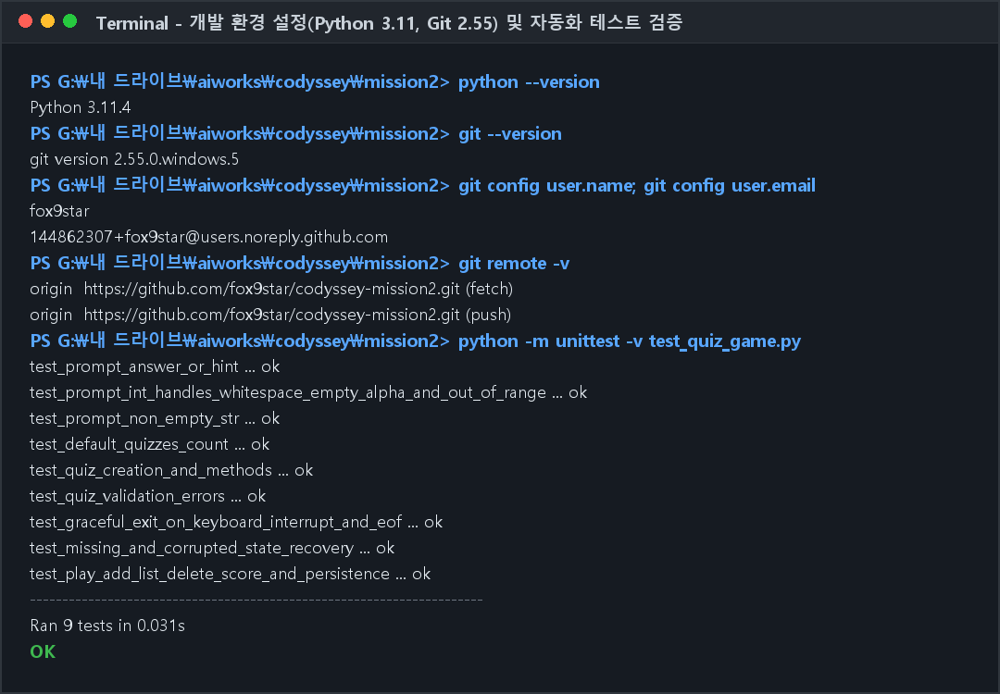
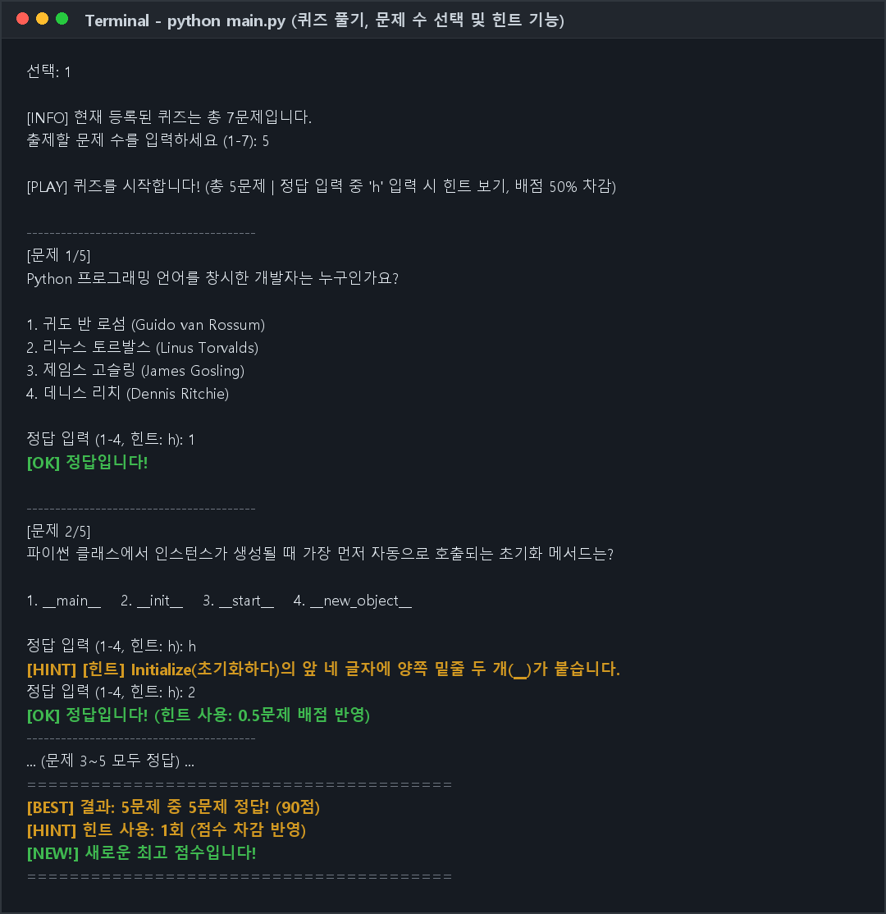
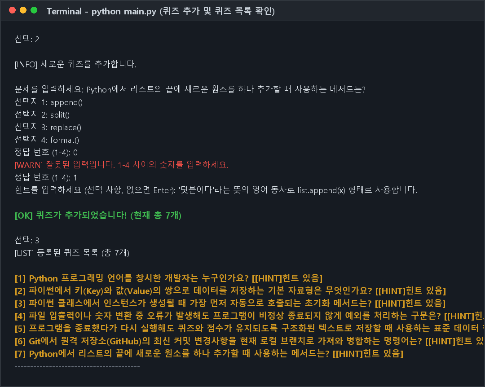
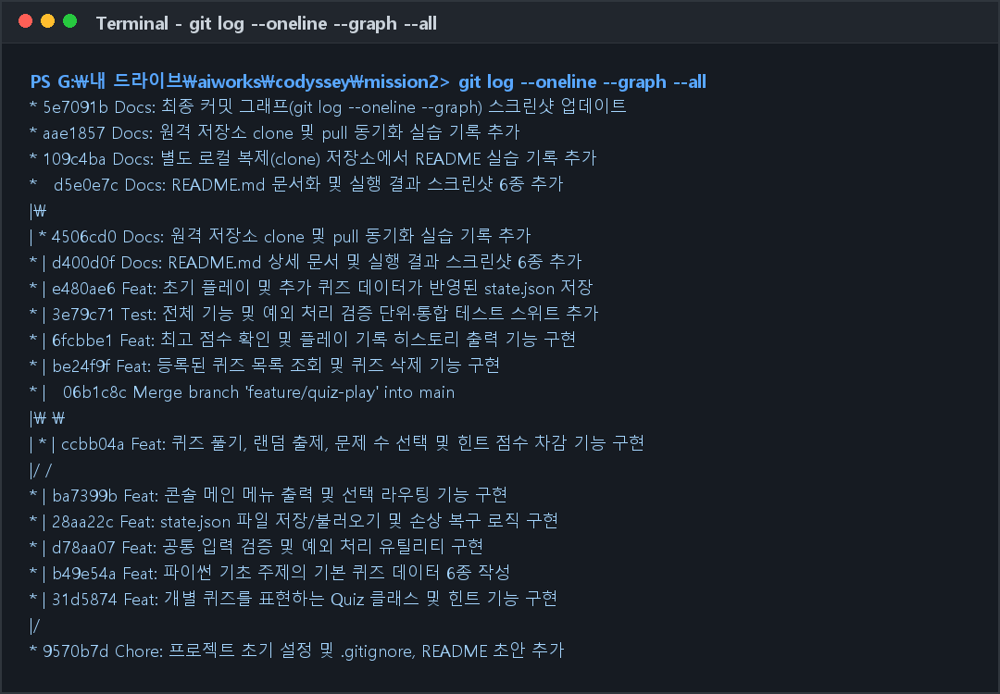

# 🎯 나만의 파이썬 콘솔 퀴즈 게임 (Codyssey Mission 2)

> **컴퓨터에게 명령 내리는 말(파이썬) 처음 배우기**  
> 외부 라이브러리 없이 Python 3 표준 라이브러리와 객체 지향 프로그래밍(`Quiz`, `StateManager`, `QuizGame`), JSON 파일 영속성(`state.json`), 그리고 Git/GitHub 브랜치 워크플로우를 활용하여 처음부터 끝까지 구현한 터미널 기반 인터랙티브 퀴즈 게임입니다.

- **GitHub 저장소 URL**: https://github.com/fox9star/codyssey-mission2
- **개발 환경**: Python 3.11.4 (표준 라이브러리만 사용) / Git 2.55.0.windows.5 / Windows PowerShell & VSCode

---

## 1. 프로젝트 개요

본 프로젝트는 터미널(콘솔) 환경에서 번호 메뉴를 선택하여 **퀴즈 풀기, 퀴즈 추가, 퀴즈 목록 조회, 점수 및 히스토리 확인, 퀴즈 삭제**를 수행할 수 있는 콘솔 애플리케이션입니다.

- **객체 지향 설계(OOP)**: 개별 퀴즈 데이터를 표현하고 검증하는 `Quiz` 클래스, `state.json` 파일 입출력과 손상 복구를 전담하는 `StateManager` 클래스, 게임 전체 메뉴 흐름과 상태를 조율하는 `QuizGame` 클래스의 **3개 클래스**로 책임을 명확히 분리했습니다.
- **데이터 영속성(Persistence)**: 프로젝트 루트의 `state.json` 파일(UTF-8 인코딩)에 등록된 퀴즈 목록, 최고 점수(`best_score`), 전체 플레이 기록(`history`)을 자동 저장하고 불러와 프로그램을 종료한 뒤 다시 실행해도 데이터가 그대로 유지됩니다.
- **견고한 입력/예외 처리**: 앞뒤 공백 제거(`.strip()`), 빈 입력(Enter), 숫자 변환 실패(`abc`), 허용 범위 밖 숫자(`0`, `9`), 파일 부재 및 JSON 손상 복구, 실행 중 `Ctrl+C`(`KeyboardInterrupt`) 및 `EOFError` 안전 저장 종료까지 모두 처리합니다.
- **보너스 과제 5종 전체 구현**: 랜덤 출제(`random.sample`), 출제 문제 수 선택, 풀이 중 힌트 보기(`h`) 및 배점 차감, 등록된 퀴즈 삭제, 날짜/시간별 점수 기록 히스토리를 모두 포함합니다.

---

## 2. 퀴즈 주제 선정 이유

- **선정 주제**: **파이썬(Python) & 프로그래밍/Git 기초**
- **선정 이유**:
  1. 본 미션의 핵심 학습 목표인 **Python 기초 문법(자료형, 예외 처리), 객체 지향(`__init__`, 클래스), JSON 파일 입출력(`json` 모듈), Git 명령어(`git checkout`, `git pull`)**를 퀴즈 문제로 직접 구성하여, 게임을 플레이하는 과정 자체가 미션 학습 내용을 복습하고 점검하는 도구가 되도록 설계했습니다.
  2. 누구나 직관적으로 이해할 수 있는 4지선다 문제와 핵심 개념을 짚어주는 **힌트(`hint`)**를 함께 작성하여, 퀴즈 추가/삭제 및 힌트 차감 기능을 자연스럽게 테스트할 수 있습니다.

### 기본 탑재된 퀴즈 (6문항 + 추가 예시 1문항)
1. Python 프로그래밍 언어를 창시한 개발자는 누구인가요? (`정답: 1번 귀도 반 로섬`)
2. 파이썬에서 키(Key)와 값(Value)의 쌍으로 데이터를 저장하는 기본 자료형은 무엇인가요? (`정답: 3번 dict`)
3. 파이썬 클래스에서 인스턴스가 생성될 때 가장 먼저 자동으로 호출되는 초기화 메서드는? (`정답: 2번 __init__`)
4. 파일 입출력이나 숫자 변환 중 오류가 발생해도 프로그램이 비정상 종료되지 않게 예외를 처리하는 구문은? (`정답: 3번 try / except`)
5. 프로그램을 종료했다가 다시 실행해도 퀴즈와 점수가 유지되도록 구조화된 텍스트로 저장할 때 사용하는 표준 데이터 형식은? (`정답: 1번 JSON`)
6. Git에서 원격 저장소(GitHub)의 최신 커밋 변경사항을 현재 로컬 브랜치로 가져와 병합하는 명령어는? (`정답: 3번 git pull`)
7. *(추가 예시)* Python에서 리스트의 끝에 새로운 원소를 하나 추가할 때 사용하는 메서드는? (`정답: 1번 append()`)

---

## 3. 실행 방법

### 3.1 요구 사항 확인
Python 3.10 이상이 설치되어 있어야 합니다. (외부 패키지 설치 불필요)

```bash
python --version
# Python 3.11.4
```

### 3.2 저장소 복제 및 게임 실행

```bash
# 1. GitHub 저장소 복제 (Clone)
git clone https://github.com/fox9star/codyssey-mission2.git
cd codyssey-mission2

# 2. 퀴즈 게임 실행
python main.py
```

### 3.3 자동화 단위/통합 테스트 실행

```bash
python -m unittest -v test_quiz_game.py
```

---

## 4. 기능 목록

| 구분 | 메뉴/기능명 | 상세 설명 |
| :--- | :--- | :--- |
| **필수** | **메인 메뉴 및 입력 검증** | `1~6`번 메뉴 출력 및 번호 선택. 앞뒤 공백 자동 제거, 빈 입력(Enter)·문자 입력(`abc`)·범위 밖 숫자(`0`, `9`) 입력 시 경고 출력 후 재입력 루프 복귀 |
| **필수** | **1. 퀴즈 풀기** | 등록된 퀴즈를 출제하고 사용자 정답(`1~4`)을 입력받아 정답/오답 여부 즉시 판정, 전체 풀이 완료 후 100점 만점 환산 점수 및 최고 점수 갱신 여부 출력 |
| **필수** | **2. 퀴즈 추가** | 새로운 문제, 선택지 1~4번, 정답 번호(`1~4`), 선택적 힌트를 입력받아 `Quiz` 인스턴스를 생성하고 즉시 `state.json`에 저장 |
| **필수** | **3. 퀴즈 목록** | 현재 저장된 전체 퀴즈 개수와 번호별 문제 목록(힌트 등록 여부 배지 포함) 출력. 퀴즈가 0개일 때 안내 메시지 출력 |
| **필수** | **4. 점수 확인** | 달성한 최고 점수(`best_score`)와 정답 개수 확인. 아직 한 번도 퀴즈를 풀지 않은 경우 안내 메시지 출력 |
| **필수** | **데이터 영속성 및 복구** | 프로젝트 루트 `state.json`에 UTF-8로 자동 저장/로드. 파일이 없으면 기본 퀴즈 6문항으로 초기화하고, 파일이 손상되었으면 경고 후 기본 데이터로 자동 복구 |
| **필수** | **안전 종료 처리** | 실행 중 `Ctrl+C`(`KeyboardInterrupt`) 또는 입력 스트림 종료(`EOFError`) 발생 시 Traceback 없이 안내 메시지를 출력하고 `state.json` 저장 후 안전하게 종료 |
| **보너스 1** | **랜덤 출제** | `random.sample()`을 사용하여 매 게임마다 문제 출제 순서를 무작위로 섞어 출제 |
| **보너스 2** | **문제 수 선택** | 퀴즈 시작 전 등록된 전체 퀴즈(`1 ~ N`개) 중 원하는 출제 문항 수를 직접 선택 가능 |
| **보너스 3** | **힌트 기능 및 점수 차감** |`Quiz` 클래스에 `hint` 속성을 추가하고, 정답 입력 중 `h`(또는 `hint`) 입력 시 힌트 출력. 힌트를 사용한 문제는 정답 시 배점의 50% 차감 반영 |
| **보너스 4** | **5. 퀴즈 삭제** | 등록된 퀴즈 목록을 확인하고 선택한 번호의 퀴즈를 삭제한 뒤 즉시 `state.json`에 반영 |
| **보너스 5** | **점수 기록 히스토리** | 최고 점수뿐만 아니라 모든 플레이 이력(날짜/시간 `timestamp`, 출제 문항 수, 정답 수, 힌트 사용 횟수, 최종 점수)을 `state.json`에 누적 기록 및 출력 |

---

## 5. 파일 구조

```text
codyssey-mission2/
├── main.py               # 프로그램 진입점 (UTF-8 콘솔 설정 및 QuizGame 실행)
├── quiz.py               # 개별 퀴즈를 표현하는 Quiz 클래스 (속성 검증, 출력, 정답 확인, 힌트, 직렬화)
├── default_data.py       # 초기 실행 및 손상 복구 시 사용하는 기본 퀴즈 데이터 6문항 생성 모듈
├── input_utils.py        # 공통 입력/예외 처리 모듈 (공백 제거, 빈 입력, 숫자 변환 실패, 범위 검증)
├── storage.py            # state.json 파일 저장/불러오기 및 손상 복구를 담당하는 StateManager 클래스
├── quiz_game.py          # 게임 전체 상태와 메뉴 기능을 관리하는 QuizGame 클래스
├── state.json            # 퀴즈 목록, 최고 점수, 플레이 히스토리가 저장되는 JSON 데이터 파일 (UTF-8)
├── test_quiz_game.py     # 필수/보너스 기능 및 예외 케이스 검증용 unittest 테스트 스위트 (9개 테스트)
├── .gitignore            # Git 추적 제외 설정 (__pycache__, 가상환경, 임시 파일 등)
├── README.md             # 프로젝트 문서 및 실행 가이드
└── docs/
    └── screenshots/      # 개발 환경, 기능별 실행 결과, git log 그래프 스크린샷
        ├── env_setup.png
        ├── menu.png
        ├── play.png
        ├── add_quiz.png
        ├── score.png
        └── git_log.png
```

---

## 6. 데이터 파일 설명 (`state.json`)

- **파일 경로**: 프로젝트 루트 디렉터리의 `./state.json`
- **인코딩**: `UTF-8` (`ensure_ascii=False, indent=4` 설정으로 한글을 유니코드 이스케이프 없이 가독성 있게 저장)
- **역할**: 프로그램 종료 후 재실행 시에도 사용자가 추가/삭제한 퀴즈 목록과 최고 점수, 플레이 히스토리를 유지하는 데이터 영속성 저장소입니다.
- **예외 복구 정책**:
  - 첫 실행 시 `state.json`이 없으면 `default_data.py`의 기본 퀴즈 6문항으로 초기 `state.json`을 자동 생성합니다.
  - 파일이 외부 수정 등으로 손상(`JSONDecodeError`, 필수 키 누락, 타입 불일치)된 경우, `try / except`로 오류를 포착하여 안내 메시지를 출력하고 기본 퀴즈 데이터로 안전하게 복구합니다.
  - 명세서의 최소 스키마(`{"quizzes": [...], "best_score": 3}`)만 포함된 JSON 파일도 100% 하위 호환하여 읽어들입니다.

### `state.json` 필드 구조 (스키마)

| 필드명 | 자료형 | 설명 |
| :--- | :--- | :--- |
| `quizzes` | `list[dict]` | 등록된 모든 퀴즈 객체 리스트 |
| `quizzes[].question` | `str` | 퀴즈 문제 텍스트 |
| `quizzes[].choices` | `list[str]` | 4개의 선택지 문자열 리스트 |
| `quizzes[].answer` | `int` | 정답 번호 (`1` ~ `4`) |
| `quizzes[].hint` | `str` | *(보너스)* 문제 풀이 힌트 문자열 |
| `best_score` | `int` | 역대 최고 점수 (100점 만점 기준 정수) |
| `has_played` | `bool` | 퀴즈를 최소 1회 이상 플레이했는지 여부 |
| `best_correct` | `int` | 최고 점수 달성 시 맞힌 문제 수 |
| `best_total` | `int` | 최고 점수 달성 시 푼 전체 문제 수 |
| `history` | `list[dict]` | *(보너스)* 시간순 전체 게임 플레이 기록 리스트 (`timestamp`, `total_questions`, `correct_count`, `hints_used`, `score`) |

### `state.json` 실제 저장 예시

```json
{
    "quizzes": [
        {
            "question": "Python 프로그래밍 언어를 창시한 개발자는 누구인가요?",
            "choices": [
                "귀도 반 로섬 (Guido van Rossum)",
                "리누스 토르발스 (Linus Torvalds)",
                "제임스 고슬링 (James Gosling)",
                "데니스 리치 (Dennis Ritchie)"
            ],
            "answer": 1,
            "hint": "네덜란드 출신 프로그래머로, 코미디 쇼 'Monty Python'에서 언어 이름을 따왔습니다."
        }
    ],
    "best_score": 90,
    "has_played": true,
    "best_correct": 5,
    "best_total": 5,
    "history": [
        {
            "timestamp": "2026-11-26 03:50:12",
            "total_questions": 5,
            "correct_count": 4,
            "hints_used": 0,
            "score": 80
        },
        {
            "timestamp": "2026-11-26 03:55:40",
            "total_questions": 5,
            "correct_count": 5,
            "hints_used": 1,
            "score": 90
        }
    ]
}
```

---

## 7. 실행 화면 및 제출물 스크린샷

### 7.1 개발 환경 설정 및 테스트 검증 (`docs/screenshots/env_setup.png`)


### 7.2 메인 메뉴 및 잘못된 입력 예외 처리 (`docs/screenshots/menu.png`)


### 7.3 퀴즈 풀기 — 문제 수 선택, 힌트 차감, 최고 점수 갱신 (`docs/screenshots/play.png`)


### 7.4 퀴즈 추가 및 등록된 퀴즈 목록 조회 (`docs/screenshots/add_quiz.png`)


### 7.5 점수/히스토리 확인 및 재시작 후 데이터 유지 확인 (`docs/screenshots/score.png`)


### 7.6 `git log --oneline --graph` 커밋 및 브랜치 병합 이력 (`docs/screenshots/git_log.png`)


---

## 8. 과제 학습 목표 핵심 정리

1. **Python 기초**:
   - **변수**: 데이터를 메모리 공간에 저장하고 이름을 붙여 재사용·변경하기 위해 사용합니다 (`best_score`, `correct_count` 등).
   - **기본 자료형 차이**: `int`(정답 번호·점수 등 정수), `str`(문제·선택지·힌트 등 문자열), `bool`(`True`/`False` 논리값), `list`(순서가 있는 4개의 선택지 및 퀴즈 목록), `dict`(키-값 쌍으로 구조화된 JSON 퀴즈 데이터 및 히스토리 레코드).
   - **조건문과 반복문**: 메뉴 분기 및 정답 판별에는 `if / elif / else`를 사용하고, 정해진 횟수(4개 선택지, 출제된 문제 리스트)를 순회할 때는 `for`문을, 유효한 입력이 들어올 때까지 반복하거나 종료 전까지 메뉴를 유지할 때는 `while`문을 선택합니다.
2. **클래스와 객체**:
   - **클래스 사용 이유**: 연관된 데이터(속성)와 동작(메서드)을 하나의 설계도로 묶어 코드 중복을 줄이고 역할별로 책임을 분리하기 위해 사용합니다.
   - **`__init__`과 `self`**: `__init__`은 객체(인스턴스)가 생성될 때 초기 속성을 설정하는 생성자 메서드이며, `self`는 생성된 인스턴스 자기 자신을 가리키는 참조입니다.
3. **파일 입출력과 JSON**:
   - **JSON과 `try / except`**: JSON은 사람이 읽기 쉽고 파이썬의 `dict`/`list`와 1:1로 변환(`json.loads`, `json.dumps`)되는 표준 텍스트 데이터 형식입니다. 파일이 없거나 깨졌을 때 프로그램이 멈추지 않도록 `try / except (OSError, json.JSONDecodeError, ValueError)`로 예외를 처리합니다.
4. **Git 기초 명령어 7종**:
   - `git init`: 현재 디렉터리를 새로운 로컬 Git 저장소로 초기화합니다.
   - `git add`: 작업 디렉터리의 변경 파일을 스테이징 영역(Staging Area)에 올립니다.
   - `git commit`: 스테이징된 변경사항을 의미 있는 단위(스냅샷)로 로컬 저장소 이력에 기록합니다.
   - `git checkout`: 작업 브랜치를 전환하거나 새 브랜치를 생성(`checkout -b feature/quiz-play`)합니다.
   - `git push`: 로컬 저장소의 커밋 이력을 원격 저장소(GitHub)에 업로드합니다.
   - `git clone`: 원격 저장소 전체를 새로운 로컬 디렉터리에 복제합니다.
   - `git pull`: 원격 저장소의 최신 변경사항을 가져와 현재 로컬 브랜치에 병합합니다.
